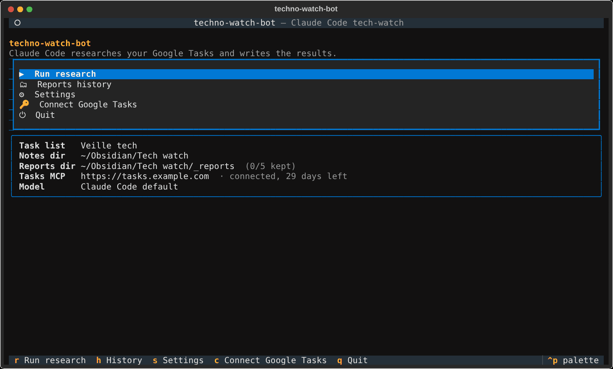
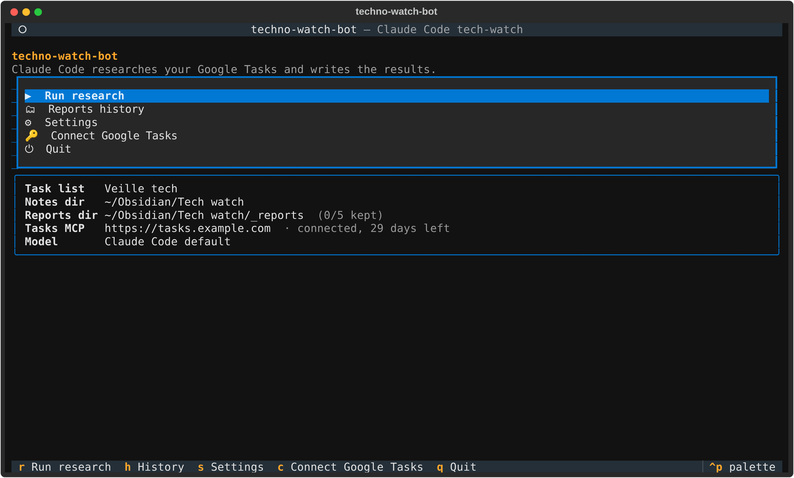
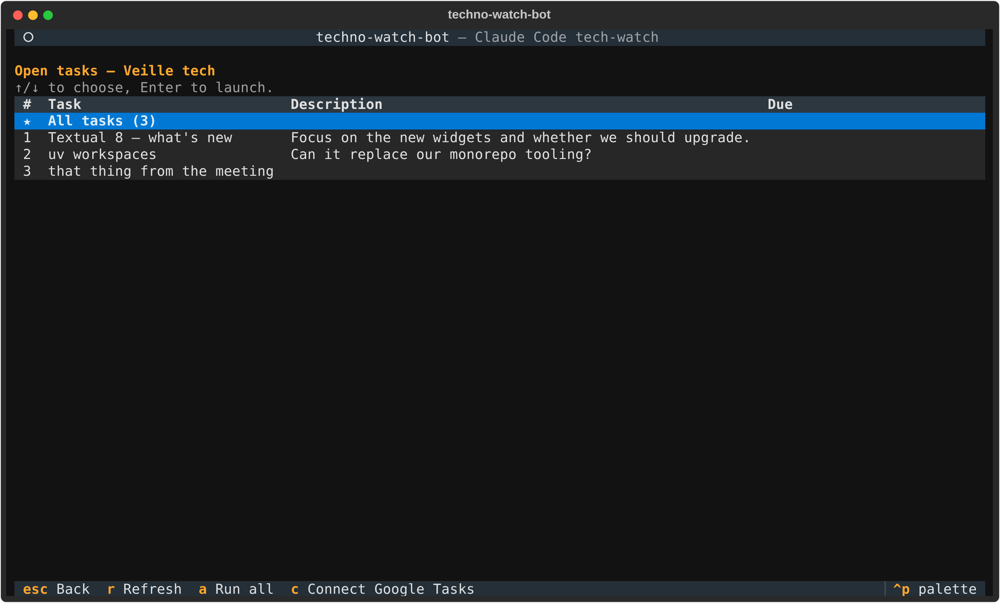
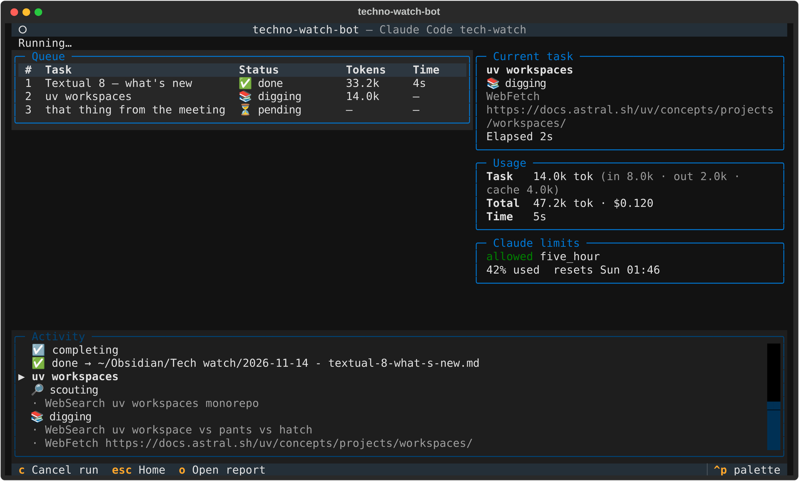
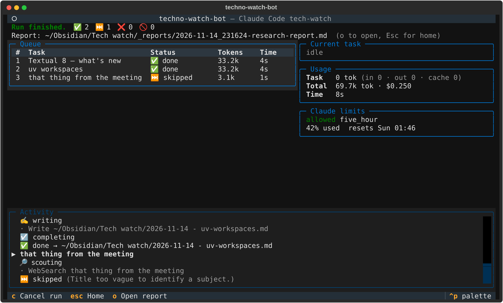
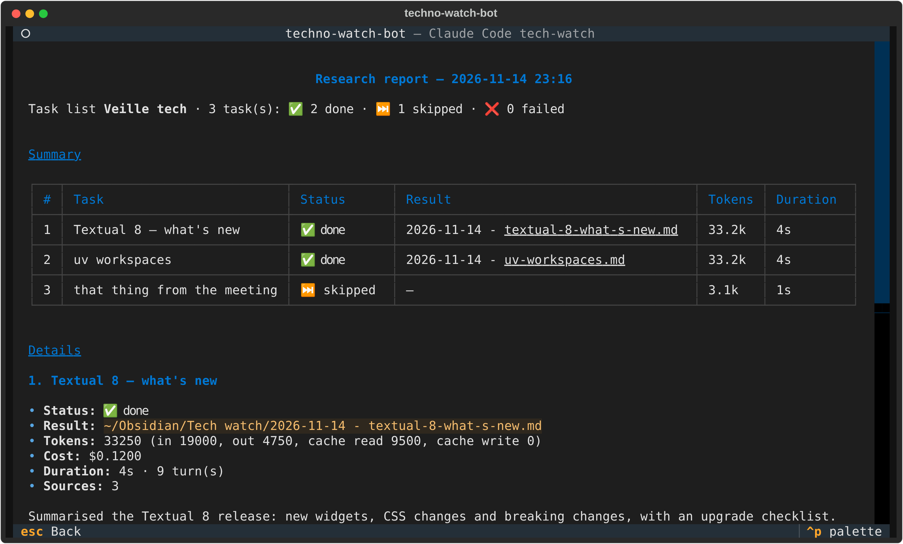
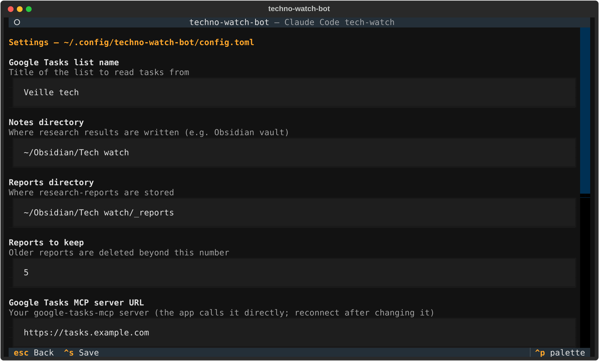
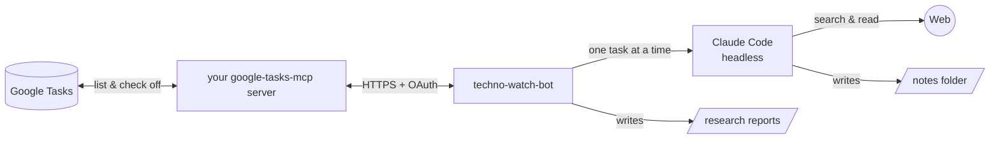

<div align="center">

# 🔭 techno-watch-bot

**Turn your "to look into" list into researched notes while you do something else.**

You note topics in Google Tasks. techno-watch-bot has Claude Code research each one
on the web, writes a clear markdown note into your Obsidian vault (or any folder),
and checks the task off.

[](https://github.com/mathisschmidt/technology_watch/releases/latest)
[](https://github.com/mathisschmidt/technology_watch/actions/workflows/release.yml)




<sub>Recorded with <code>--fake</code>: a simulated run, no Claude or Google calls.</sub>

</div>

---

## ✨ What it does

You jot down *"uv workspaces"* or *"Textual 8 — what's new"* during the day.
Later you open techno-watch-bot, pick one task or **all of them**, and watch it work:

1. **🔎 Scout**: a few quick web searches to understand what the topic is.
   Too vague or nothing public? The task is **skipped with a reason** instead of
   producing a useless note.
2. **📚 Dig**: official docs, changelogs, issues, benchmarks, reputable articles.
3. **✍️ Write**: one markdown note in your notes folder. It follows what the task
   description asks for (a comparison, a checklist, questions to answer…), or a
   clean default structure: overview, how it works, pros, cons, examples,
   comparison, conclusion, sources.
4. **☑️ Check off**: the task is marked done in Google Tasks, but only if the
   note really exists.

Each run ends with a **research report**: what was done, what was skipped and
why, and tokens, cost and time per task.

## 🎯 Highlights

| | |
|---|---|
| 🖥️ **Live monitor** | See each task's phase, the current search or page, tokens, cost, elapsed time and your Claude usage limits as it happens. |
| 🧠 **Knows when to stop** | Vague tasks are skipped with an explanation instead of hallucinated. |
| 🗂️ **Notes you keep** | Plain markdown with frontmatter (title, date, sources, tags), ready for Obsidian. |
| 📊 **Run reports** | Every run is summarised; the latest 5 are kept and browsable in the app. |
| 🔒 **Locked-down agent** | Claude can only search the web and write in your notes folder. No shell, no access to your tasks. |
| ⚙️ **Everything in the UI** | Folders, task list, server, model and limits are edited in the app. No config file to write by hand. |
| 📦 **One file to run** | Download a single executable: no Python, no install. |

## 📸 Screenshots

<table>
  <tr>
    <td width="50%"><br><b>Home</b>: menu, folders and connection status at a glance</td>
    <td width="50%"><br><b>Pick</b>: one task, or ★ all of them</td>
  </tr>
  <tr>
    <td><br><b>Monitor</b>: phase, current page, tokens, cost, limits</td>
    <td><br><b>Done</b>: notes written, vague task skipped with a reason</td>
  </tr>
  <tr>
    <td><br><b>Report</b>: per-task status, tokens, cost and summary</td>
    <td><br><b>Settings</b>: every path and option, saved for you</td>
  </tr>
</table>

## 🚀 Quick start

### 1. Download

Grab the file for your system from the
**[latest release](https://github.com/mathisschmidt/technology_watch/releases/latest)**:

| System | File |
|---|---|
| 🐧 Linux (x86_64) | `techno-watch-bot-linux-x86_64` |
| 🍎 macOS (Apple Silicon) | `techno-watch-bot-macos-arm64` |
| 🪟 Windows (x86_64) | `techno-watch-bot-windows-x86_64.exe` |

### 2. Try it with no setup

The `--fake` mode simulates everything (no Claude, no Google), so you can look around first:

```bash
chmod +x techno-watch-bot-linux-x86_64
```

```bash
./techno-watch-bot-linux-x86_64 --fake
```

<details>
<summary>macOS and Windows notes</summary>

- **macOS**: the file is not signed. After `chmod +x`, remove the quarantine flag once:
  `xattr -d com.apple.quarantine techno-watch-bot-macos-arm64`
  (or allow it in System Settings → Privacy & Security).
- **Windows**: run the `.exe` from a terminal (Windows Terminal recommended). If
  SmartScreen warns, choose **More info → Run anyway**.

</details>

### 3. Use it for real

You need:

- **[Claude Code](https://code.claude.com)** installed and logged in (`claude` works in your terminal).
  The research runs on your Claude subscription or API key.
- **A [google-tasks-mcp](https://github.com/mathisschmidt/google-tasks-mcp) server**
  (self-hosted, a few minutes to deploy). It gives the app secure access to your Google Tasks.

Then:

1. Run the app without `--fake`. The **Settings** screen opens: set your notes
   folder and paste your server URL.
2. On **Home**, choose **🔑 Connect Google Tasks**. Your browser opens the server's
   sign-in (server password, then Google). Done for 30 days.
3. **▶ Run research**, pick a task, and watch it go.

## 🧭 How it works



- **The app** (Python, [Textual](https://textual.textualize.io) TUI) lists your open
  tasks and checks them off itself, by calling your google-tasks-mcp server.
- **Claude Code** runs headless through the
  [Claude Agent SDK](https://pypi.org/project/claude-agent-sdk/), one session per
  task. It only gets the task's title and description, web search, web fetch, and
  file tools limited to your notes folder.
- **The report** is written by the app, not by Claude, so its format never changes.

## ⚙️ Settings

Everything is editable from the **Settings** screen and stored in
`~/.config/techno-watch-bot/config.toml`.

| Setting | Default | What it does |
|---|---|---|
| Google Tasks list name | `Veille tech` | The list to read tasks from |
| Notes directory | `~/techno-watch/notes` | Where notes are written (point it at your Obsidian vault) |
| Reports directory | `~/.local/share/techno-watch-bot/reports` | Where run reports go |
| Reports to keep | `5` | Older reports are deleted |
| Google Tasks MCP server URL | *(empty)* | Your google-tasks-mcp server, e.g. `https://tasks.example.com` |
| Model | *(Claude Code default)* | Any Claude model id |
| Max turns per task | `40` | Hard stop for one task |
| Scouting searches | `3` | Quick searches before deciding to dig or skip |
| Claude CLI path | *(auto)* | A specific `claude` binary |

<details>
<summary>Tips</summary>

- **Ask for a specific result** in the task description: *"compare with Poetry and
  Hatch in a table"*, *"give me a migration checklist"*, *"answer in French"*.
  Claude follows it instead of the default structure.
- **Change the default note format** in `techno_watch_bot/prompts.py`.
- **Cancel a run** with `c`: the current task stops, the rest are marked cancelled
  in the report, and nothing is checked off.

</details>

## 🔒 Privacy & safety

- Claude runs with **no MCP servers, no shell**, and permission mode `dontAsk`:
  anything not explicitly allowed is refused, so it can never stop to ask you.
- Claude **never sees your task list**. Only the app talks to your tasks server, and it
  only lists tasks and marks them completed. It never deletes anything.
- A task is checked off **only** if Claude reports success **and** the note file exists.
- Your sign-in token is stored in `~/.config/techno-watch-bot/mcp_token.json`, readable
  only by you (mode 600). Your server URL lives only in your local config.

## 🛠️ From source

Requires Python 3.11+ and [uv](https://docs.astral.sh/uv/).

```bash
git clone https://github.com/mathisschmidt/technology_watch.git
```

```bash
cd technology_watch && uv sync
```

```bash
uv run techno-watch-bot
```

<details>
<summary>Development commands</summary>

| Command | Purpose |
|---|---|
| `uv run techno-watch-bot --fake` | Run with the simulated backend |
| `uv run pytest` | Tests: config, reports, SDK stream parsing, MCP client and OAuth flow, runner, and the UI via Textual's pilot |
| `uv run --group build python scripts/build.py` | Build the single-file executable into `dist/` (add `--with-claude-cli` to embed Claude Code, about +340 MB) |
| `uv run --with playwright --with pillow python scripts/screenshots.py` | Regenerate the screenshots and demo GIF in `docs/` |

**Releasing:** push a version tag and GitHub Actions tests, builds the Linux, macOS
and Windows executables, and publishes the release:

```bash
git tag v2.1.0
```

```bash
git push origin v2.1.0
```

</details>

## ❓ FAQ

<details>
<summary><b>Does it cost anything?</b></summary>

The app is free. Research uses your own Claude Code account: a subscription's usage
limits or API billing. The monitor shows tokens, cost and your current limit status
live, and each report lists them per task.
</details>

<details>
<summary><b>Why do I need my own google-tasks-mcp server?</b></summary>

It holds the Google OAuth credentials and refreshes them, so the app only ever has a
revocable 30-day token for your server, never your Google password or Google tokens.
</details>

<details>
<summary><b>Can I use it without Obsidian?</b></summary>

Yes. Notes are plain markdown files in whatever folder you choose.
</details>

<details>
<summary><b>"Could not load tasks"?</b></summary>

Check the server URL in Settings, then **Connect Google Tasks** again (tokens last
30 days). The message shows the server's exact error, including the names of your
lists if the configured one isn't found.
</details>

---

<div align="center">
<sub>Built with <a href="https://textual.textualize.io">Textual</a>, <a href="https://typer.tiangolo.com">Typer</a> and the <a href="https://pypi.org/project/claude-agent-sdk/">Claude Agent SDK</a>.</sub>
</div>
